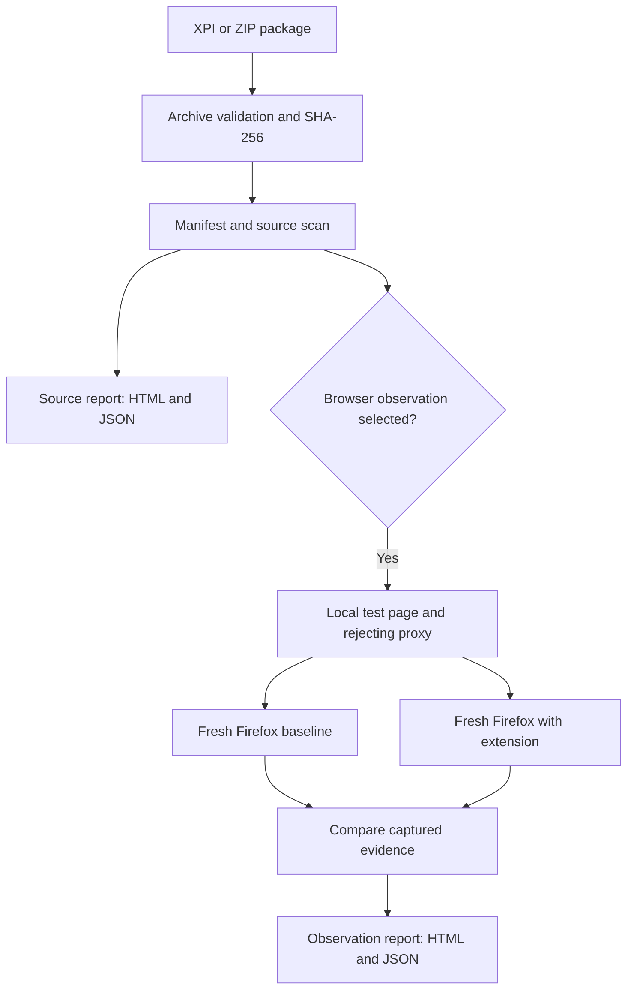

# Architecture and data flow

XInspect has a local web interface and a CLI. Both use the same analysis functions. The web server accepts a package from the browser, stores it temporarily, runs the selected workflow, and saves reports under `reports/web/`. It listens on loopback and handles one analysis at a time.

## Source review

`src/archive.ts` validates the ZIP structure and limits. `src/manifest.ts` extracts permissions and entry points. `src/scan.ts` parses JavaScript and inline HTML scripts for selected signals. `src/analyze.ts` groups signals into findings with file and line evidence, and `src/report.ts` produces the browser-readable report.

## Browser observation

`src/dynamic/observe.ts` first runs source review and checks that the package bytes have not changed. It starts the local page and rejecting HTTP(S) proxy, then calls `src/dynamic/browser.ts` twice. Each run gets a fresh temporary Firefox profile. The first run establishes a baseline; the second installs the extension temporarily. `src/dynamic/bidi.ts` sends WebDriver BiDi commands and receives browser events. `src/dynamic/report.ts` presents the comparison.

`src/web.ts` polls job progress and serves saved reports. `src/cli.ts` prints the same progress in the terminal. See [source review](source-review.md) and [browser observation](browser-observation.md) for coverage and limits.
